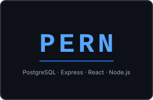

# Hello! I'm Joseph 👋

<h3 align="center">
  I'm a full-stack software engineer who believes in learning the fundamentals, building a strong foundation, and using AI as a force multiplier.
</h3>

<table>
  <tr>
    <td width="32%" align="center" valign="middle">
      
    </td>
    <td width="34%" align="center" valign="middle">
      
    </td>
    <td width="34%" align="center" valign="middle">
      
    </td>
  </tr>
</table>
